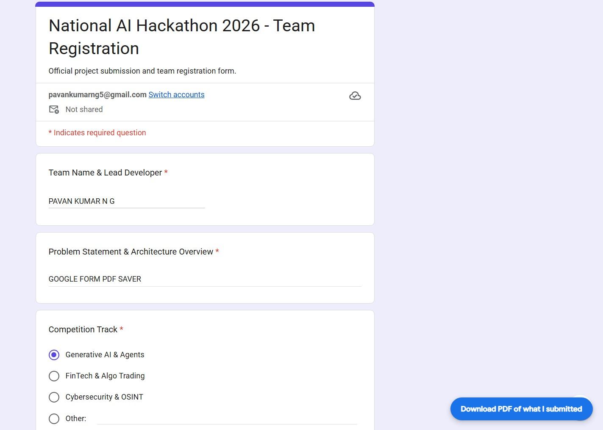
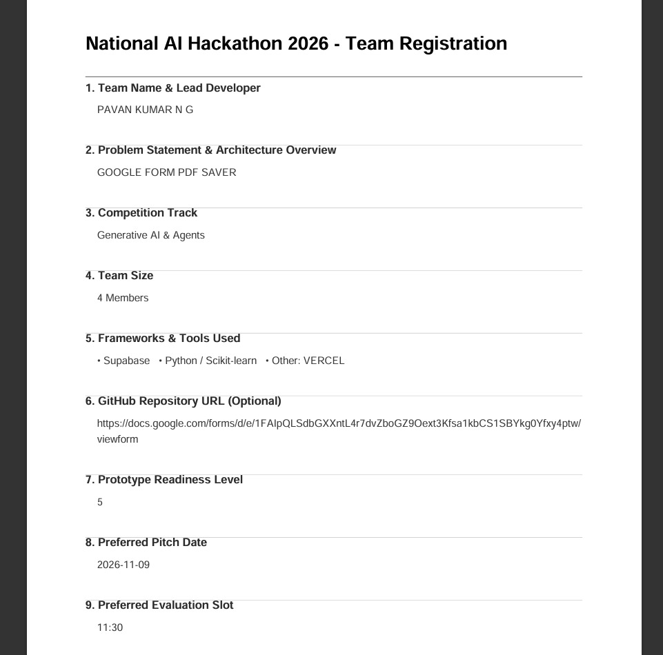

# Form PDF Saver

> **A privacy-first browser extension for Microsoft Edge and Google Chrome.**  
> Download your Google Form answers as a PDF — with one click, entirely in your browser.

---

## Screenshots

| Floating button on form | PDF output |
|---|---|
|  |  |

## Features

- **One-click PDF export.** A floating "Save answers as PDF" button appears on every Google Form respondent page (`/viewform`).
- **Multi-section support.** Answers from every section are captured automatically as you navigate Next/Back — the PDF always contains the complete form.
- **Submit-safe.** A final snapshot is taken the moment you click Submit, so the last section is never lost.
- **Post-submit download.** After submitting, a "Download PDF of what I submitted" button appears on the confirmation page (`/formResponse`) — your last chance to save.
- **All common question types:** short text, paragraph, multiple-choice (including "Other"), checkboxes, dropdown, linear scale, date, and time.
- **Shadow DOM isolation.** The injected button lives in a Shadow DOM so our CSS cannot affect Google's form and Google's CSS cannot affect our button.
- **Zero permissions requested.** The extension only runs on `https://docs.google.com/forms/*`.
- **Fully local.** No network requests, no analytics, no data collection. See [PRIVACY.md](PRIVACY.md).
- **No build step.** Plain ES2020 JavaScript, Manifest V3.

---

## Project Structure

```
form-pdf-saver/
│
├── manifest.json          # MV3 manifest — content scripts, icons, metadata
│
├── lib/
│   └── jspdf.umd.min.js   # ⚠ ADD THIS FILE YOURSELF (see "Adding jsPDF" below)
│                          # Bundled locally — never fetched from the internet
│
├── icons/
│   ├── icon16.png         # Toolbar icon 16×16 px  (solid Google-blue placeholder)
│   ├── icon48.png         # Extensions page icon 48×48 px
│   └── icon128.png        # Store listing icon 128×128 px
│
├── src/
│   ├── selectors.js       # ALL DOM selectors — no class names, only role/aria/tag/data
│   ├── extractor.js       # Pure DOM reader → structured question/answer array
│   ├── state.js           # Cross-section accumulator with sessionStorage persistence
│   ├── pdf.js             # jsPDF wrapper — builds and downloads the PDF
│   ├── ui.js              # Shadow DOM floating button + stacking toast notifications
│   └── content.js         # Entry point: page guards, bootstraps, wires everything
│
├── TESTING.md             # Manual test checklist
├── PRIVACY.md             # Plain-language privacy policy
└── README.md              # This file
```

### File responsibilities

| File | Responsibility |
|---|---|
| `manifest.json` | Extension metadata and content-script loading order |
| `lib/jspdf.umd.min.js` | PDF generation library (you supply this) |
| `src/selectors.js` | Every DOM selector — zero generated class names |
| `src/extractor.js` | Reads the live form DOM → `[{ id, title, type, answer }]` |
| `src/state.js` | Accumulates answers across sections; persists to `sessionStorage` |
| `src/pdf.js` | Builds an A4 PDF via jsPDF and triggers browser download |
| `src/ui.js` | Floating Shadow DOM button + stacking toast notifications |
| `src/content.js` | Boots on `/viewform` and `/formResponse`; wires UI ↔ state ↔ PDF |

---

## Adding jsPDF

This extension does **not** fetch jsPDF from the internet. You must supply the file yourself:

1. Go to the [jsPDF releases page](https://github.com/parallax/jsPDF/releases).
2. Under **Assets**, download `jspdf.umd.min.js` from the latest release.
3. Place it at `lib/jspdf.umd.min.js` inside this project folder.

> Do **not** use a CDN link — the extension has no network access and would silently fail.

---

## Installing in Microsoft Edge

1. Open Edge and go to `edge://extensions`.
2. Enable **Developer mode** (toggle — bottom-left corner).
3. Click **Load unpacked**.
4. Select the `form-pdf-saver` folder (the one containing `manifest.json`).
5. Confirm the extension appears in the list and is **enabled** (the toggle is on).

> **Tip:** After editing any source file, return to `edge://extensions` and click the **↺ Reload** icon on the extension card, then refresh the form page.

---

## Installing in Google Chrome

1. Open Chrome and go to `chrome://extensions`.
2. Enable **Developer mode** (toggle — top-right corner).
3. Click **Load unpacked**.
4. Select the `form-pdf-saver` folder.
5. Confirm the extension is enabled.

---

## How to Use

### While filling in a form

1. Open any Google Form respondent link (URL contains `/viewform`).
2. A floating **"Save answers as PDF"** button appears in the bottom-right corner.
3. Fill in your answers. For multi-section forms click **Next** as normal — answers from every section are captured automatically.
4. Click **"Save answers as PDF"** at any time to download a PDF of everything captured so far.

### After submitting

1. After clicking **Submit**, Google redirects to a confirmation page (`/formResponse`).
2. If the extension captured answers for this form, a **"Download PDF of what I submitted"** button appears.
3. Click it to download the PDF. The button updates to **"PDF downloaded ✓"** and the saved data is cleared.

> **Note:** Saved data lives in `sessionStorage` for the current tab only. Closing the tab clears it.

---

## How Multi-Section Capture Works

Google Forms removes earlier sections from the DOM when the respondent clicks **Next**. The extension handles this transparently:

| Event | What happens |
|---|---|
| Any keystroke or selection | Auto-snapshot via `input`/`change`/`click` listeners |
| DOM structure change (Next/Back) | Debounced MutationObserver triggers another snapshot |
| Submit button click | Synchronous final snapshot before page navigation |
| `/formResponse` page load | Answers hydrated automatically from `sessionStorage` |

---

## Packaging for Store Upload

Run this PowerShell one-liner from the project root to produce `form-pdf-saver.zip` containing only the production files:

```powershell
Compress-Archive -Path manifest.json, lib, src, icons -DestinationPath form-pdf-saver.zip -Force
```

The zip will contain exactly: `manifest.json`, `lib/`, `src/`, `icons/`.  
No `.git`, markdown docs, test files, or scratch scripts are included.

---

## Keeping Selectors Up to Date

Google occasionally ships changes to its Forms DOM. If the button stops appearing or answers are not captured:

1. Open `src/selectors.js`.
2. Use DevTools (F12 → Elements tab) to inspect the new DOM structure on the form page.
3. Update the relevant selector — **only in `selectors.js`** — and reload the extension.

---

## Known Limitations

| Limitation | Detail |
|---|---|
| **File uploads not captured** | Google Forms file-upload questions attach files to your Drive; there is no text value to read. The question will show "(No answer)" in the PDF. |
| **Non-Latin characters (v1)** | jsPDF's built-in Helvetica font supports Latin-1 (Western European). Cyrillic, Arabic, CJK, and other scripts may render as boxes. A future version can embed a Unicode font. |
| **Google markup changes** | The extension uses ARIA roles and attributes to find questions. If Google significantly changes its DOM structure, selectors may need updating (see `src/selectors.js`). |
| **Single-tab sessionStorage** | Answers are saved per browser tab. If you open the form in a new tab, the new tab starts fresh. |
| **Dynamic forms not fully supported** | Forms that use conditional logic to show/hide sections may show questions in an unexpected order if the respondent jumps back and changes answers. |

---

## Privacy & Permissions

| Property | Detail |
|---|---|
| Permissions declared | **None** |
| Pages the script runs on | `https://docs.google.com/forms/*` only |
| Data storage | `sessionStorage` for the current tab only — cleared on tab close |
| Network requests | **None** |
| Analytics / telemetry | **None** |
| Data sent to any server | **Never** |

See [PRIVACY.md](PRIVACY.md) for the full policy.

---

## License

MIT License

Copyright © 2026 PAVAN KUMAR N G

Permission is hereby granted, free of charge, to any person obtaining a copy of this software and associated documentation files (the "Software"), to deal in the Software without restriction, including without limitation the rights to use, copy, modify, merge, publish, distribute, sublicense, and/or sell copies of the Software, and to permit persons to whom the Software is furnished to do so, subject to the following conditions:

The above copyright notice and this permission notice shall be included in all copies or substantial portions of the Software.

THE SOFTWARE IS PROVIDED "AS IS", WITHOUT WARRANTY OF ANY KIND, EXPRESS OR IMPLIED, INCLUDING BUT NOT LIMITED TO THE WARRANTIES OF MERCHANTABILITY, FITNESS FOR A PARTICULAR PURPOSE AND NONINFRINGEMENT. IN NO EVENT SHALL THE AUTHORS OR COPYRIGHT HOLDERS BE LIABLE FOR ANY CLAIM, DAMAGES OR OTHER LIABILITY, WHETHER IN AN ACTION OF CONTRACT, TORT OR OTHERWISE, ARISING FROM, OUT OF OR IN CONNECTION WITH THE SOFTWARE OR THE USE OR OTHER DEALINGS IN THE SOFTWARE.
